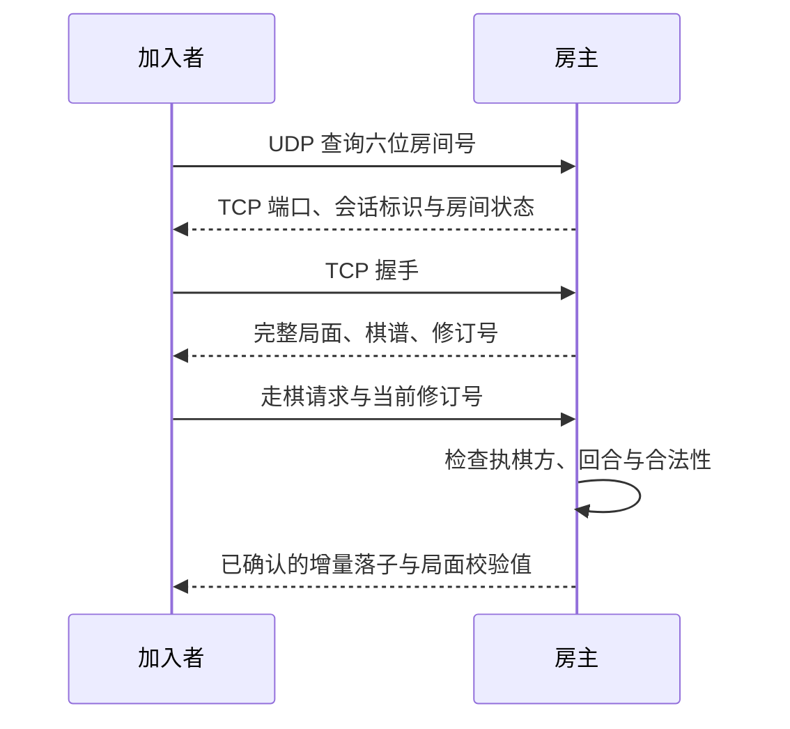

# 中国象棋课程设计说明

## 项目与运行环境

项目采用 C++17、Qt Widgets 和 CMake，实现本地双人对弈、人机对弈、残局挑战及局域网房间对弈。Linux 使用 GCC 工具链中的 `g++` 编译 C++ 源码。

### Ubuntu 编译与运行

在本项目源码目录打开终端，安装构建依赖。

```bash
sudo apt update
sudo apt install build-essential cmake qt6-base-dev qt6-tools-dev \
  qt6-tools-dev-tools qt6-l10n-tools qt6-svg-dev qt6-multimedia-dev \
  libqt6opengl6-dev fonts-noto-cjk
```

随后配置、编译并运行。

```bash
cmake -S . -B build-linux \
  -DCMAKE_CXX_COMPILER=g++ \
  -DCMAKE_BUILD_TYPE=Release \
  -DSKIP_DEPLOY=ON \
  -DBUILD_TESTING=ON
cmake --build build-linux -j2
ctest --test-dir build-linux --output-on-failure
./bin/ChineseChess
```

`-j2` 适合分配两个 CPU 核心的虚拟机。Qt 图形界面需要桌面会话，自动测试使用 Qt 的 offscreen 平台。图片和音效通过 Qt 资源系统编入程序。Linux 中文字体优先选择可用的 Noto CJK、思源或文泉驿字体。

Windows 发行目录为 `bin`，运行 `ChineseChess.exe`。分发时保留整个目录中的 DLL 和插件子目录。

## 操作说明

### 对局操作

- 本地双人对弈由两位玩家轮流操作同一台电脑。
- 人机对弈可选择简单、中等、困难三种难度。
- 残局挑战可选择内置局面及 AI 难度。
- 点击己方棋子进行选择，再点击合法位置落子。绿色圆点表示可移动的空位，绿色圆环表示可吃的目标。
- “悔棋”恢复此前局面，人机模式会尽量恢复到玩家的回合。
- “认输”在确认后结束本局。“求和”在本地确认后结束，联机时需要另一位玩家同意。
- 游戏设置提供音效、音量、动画速度、走棋轨迹、合法落点和退出确认选项，保存后下次启动继续生效。
- 对局结束后显示胜负或和棋、结束原因、用时和步数，可查看棋盘、再来一局或返回菜单。

### 棋谱保存与复盘

- 在对局左侧点击“保存棋谱”，将当前对局保存为 `.cchess` 文件。
- 主菜单打开“棋谱库”，可查看最近保存或打开的 30 份棋谱的模式、结果、步数和用时，也可以浏览已有文件进入复盘。列表记录本地文件路径。
- 对局中点击“复盘”可直接查看当前走棋记录。

本地双人和人机对弈在开局页可选择不限时或每方 5、10、15 分钟。限时对局独立记录双方剩余时间，落子后切换棋钟，超时判负，期间关闭悔棋。人机开局还可选择执红或执黑。

从主菜单发起的单机对局会在开局、落子、悔棋和正常退出时自动保存。程序关闭期间棋钟停止，下次选择“继续上局”可恢复最近的对局。棋谱库的“未完成对局”提供其他存档入口，“已结束对局”可打开自动归档的终局棋谱。联机仍使用房间内同步的总用时。
- 复盘支持回到开局、上一步、下一步、最后一步和滑块跳转，方向键左右切换，Home / End 跳到首尾。
- 点击“从此处续局”创建独立对局。人机棋谱保留原难度与 AI 执棋方，联机棋谱转为本地双人对弈。已结束棋谱可退回较早步骤后续局。
- 从最后一步恢复未完成对局时保留已记录用时，从中途分支续局时重新计时。残局棋谱保留其初始摆位，续局后的重新开始也恢复该摆位。

棋谱采用带格式版本的 JSON，保存初始局面、走棋过程、执棋方、模式、计时和结果。写入使用 `QSaveFile` 原子替换，载入会校验字段类型、坐标、回合、吃子目标和每一步的合法性。文件上限为 4 MiB，最多支持 4096 步。

### 残局与象棋指南

- “残局挑战”页面可浏览题目说明、执棋方和先手，并在同一页面选择 AI 难度。
- “象棋指南”提供棋子走法、对局规则和游戏操作三个标签页。

### 自由摆棋

- 从主菜单进入“自由摆棋”。可以在标准开局上修改，或清空后重新摆放。先选择棋子或“移除”，再点击棋盘交叉点。
- 选择先手和对弈方式，程序会检查将帅、九宫、象位、兵卒位置、后行方是否被将军，以及先手是否有合法走法。
- “开始对弈”从编辑的局面启动双人或人机对局。人机默认中等难度。“保存局面”生成可分享的 .cchess 文件，可在棋谱库打开并选择“从此处续局”。

### 局域网房间

1. 两端使用相同的新版本程序，连接同一局域网。
2. 房主选择“局域网联机”，点击“创建房间”，将六位房间号告知另一位玩家。
3. 加入者输入房间号。自动搜索失败时，可填写房主 IPv4 地址。
4. 连接成功后房主执红，加入者执黑，加入者的棋盘自动翻转。
5. 悔棋、重新开始、求和需要另一位玩家确认，15 秒内未确认自动取消。
6. 断线后暂停对局。房主保持窗口打开，加入者点击“重新连接”，恢复房主保存的局面和棋谱。

房间发现使用 UDP 45454。对局使用房主动态分配的 TCP 端口。防火墙需要允许程序在使用的局域网通信，路由器的访客网络隔离可能影响发现与连接。房主退出后房间结束。

## 模块结构

| 文件或类 | 职责 |
| --- | --- |
| `ChooseMainWindow` | 模式选择与窗口导航 |
| `ChessBoard` | 棋盘绘制、输入、历史记录、计时和终局展示 |
| `ChessPieces`、`ChessStep` | 棋子状态与走棋记录 |
| `ChessRecord`、`ReplayGame` | 棋谱文件、合法性校验、逐步复盘与分支续局 |
| `ChessRules` | 棋子走法、将军检测、合法走法与无棋可走判定 |
| `ChessSearch` | 独立局面上的 AI 搜索 |
| `MachineGame` | 后台搜索调度、取消与结果应用 |
| `PuzzleGame`、`PuzzleData` | 残局加载与人机对弈衔接 |
| `LanRoom` | UDP 发现、TCP 连接、消息分帧和心跳 |
| `LanRoomDialog`、`NetworkGame` | 房间入口、执棋权限和对局同步 |
| `GameTheme`、`GameSettings` | 界面主题、字体回退与用户偏好 |
| `GameResultDialog`、`ChessVoice` | 结果页面与音效 |

## 规则实现

合法走棋先检查坐标、目标占用和棋子自身走法，再计算落子后的将帅安全。假想落子通过只读局面叠加计算，避免每个候选走法都复制含字符串的完整棋子数组。

所有模式共用 `ChessRules`，包含马腿、象眼、炮架、兵卒过河和九宫限制。落子不能使己方将帅受攻，也不能造成将帅直接照面。被将军时，只能选择能够解除将军的走法。内置残局已调整将帅照面、非法士位和兵卒位于起始线后方等初始摆位问题，并加入自动检查。

每步完成后检查对方是否存在合法走法。无合法走法且被将军时判将死，无合法走法且未被将军时判困毙，两种情况均判无棋可走一方负。保留将帅被吃的兼容终局处理，便于处理历史局面及异常局面。双方同意时可和棋。

同一局面连同行棋方出现至少三次时，界面显示重复次数及求和、变招提示。局面比较使用棋子类型、颜色和位置，同类棋子的内部编号互换仍视为相同局面。计数随悔棋、重新开始、棋谱加载及联机局面恢复更新，吃子后的统计跳过此前局面。双方可通过求和结束重复对局，长将和长捉的比赛责任裁定仍需进一步实现。

## AI 与流畅度

AI 使用带位置分的局面评估、吃子优先排序、迭代加深和 Alpha-Beta 剪枝。每次搜索拥有独立的 65536 项固定容量置换表，通过增量局面键缓存相同剩余深度下的精确分数及上下界，缓存的最佳走法优先参与下一轮搜索。仅完整搜索的节点进入缓存，取消和超时会恢复落子前的局面。简单、中等、困难的目标搜索深度分别为 1、3、5 层。简单和中等设置 700 毫秒预算，困难设置 2000 毫秒预算，超时后使用已完成深度的结果。

后台线程持有独立局面，通过 Qt Concurrent 执行计算。主线程处理输入和绘制，搜索完成后检查取消标记、回合和历史记录，确认结果适用于当前局面后再落子。重新开始、悔棋或关闭窗口会取消过期搜索。

棋盘、棋子和背景使用绘制缓存。走子动画只更新棋盘区域，支持关闭及速度调整。AI 回复和胜负弹窗等待当前走子动画结束，避免动画中途被覆盖。

## 网络协议与同步



房主维护权威局面。加入者提交走棋请求，房主验证后双方应用同一步。每次状态变更递增修订号，重新开始递增对局标识。正常走棋传输增量消息，初次加入、重连、悔棋和状态恢复传输完整棋谱。

TCP 消息采用紧凑 JSON 加换行符分帧，接收端保留未完成消息，逐条处理合并到达的消息，并限制单帧及发送积压大小。握手校验协议和房间会话，第三位玩家无法进入已有两人的房间。

双方使用心跳检测断线。局面摘要采用 SHA-256，发现修订号或摘要不一致时请求完整状态，恢复后继续对弈。悔棋、重开和求和通过带唯一标识的提案确认，超时取消。

## 自动测试与验收

2026 年 11 月 17 日的验证覆盖以下环境。

| 环境 | 验证结果 |
| --- | --- |
| Windows、MSVC 14.43、Qt 6.8.3 | 三组 CTest 通过，包含 760×500 紧凑布局检查 |
| VMware 中的 Ubuntu 25.10、GCC 15.2.0、Qt 6.9.2 | 源码编译通过，三组 CTest 通过，中文渲染已检查 |
| Ubuntu 桌面 Wayland 会话 | 主菜单启动检查通过 |
| Ubuntu 房主与 Windows 加入者 | 经虚拟网络验证 UDP 地址查询、TCP 握手、双方走棋和吃子同步 |

启用 `BUILD_TESTING` 后，CTest 提供以下三组测试。

| 测试 | 覆盖内容 |
| --- | --- |
| `chess_rules` | 送将、应将、将帅照面、象不过河、死子、将死、困毙和有时限的合法 AI 走法 |
| `chess_ui` | 菜单导航、中文字体、设置保存、棋谱、吃子、悔棋、动画、紧凑窗口、结果页面和 AI 取消 |
| `chess_network` | 房间发现、TCP 分帧、越权或过期请求、走棋、将死、悔棋、重开、求和、认输、超时、局面修复及重新连接 |

测试使用临时设置目录，避免覆盖玩家偏好。界面测试会将预览图片写入系统临时目录的 `ChineseChess-test-artifacts`。

跨系统通信探针包含在网络测试程序中。房主端输出房间号文件，加入端使用该房间号和房主地址，验证红黑双方落子及吃子同步。

```bash
# 在 Linux 房主端运行
QT_QPA_PLATFORM=offscreen ./build-linux/tests/chess_network_test --peer-host /tmp/chess-room.txt

# 读取文件中的房间号，在另一端使用对应网络测试程序运行
QT_QPA_PLATFORM=offscreen ./build-linux/tests/chess_network_test --peer-join 房间号 房主IPv4
```

两个物理设备之间的 Wi-Fi、防火墙和路由器行为仍应在最终演示网络中验收。音效听感需要在有音频输出的桌面会话中检查。
